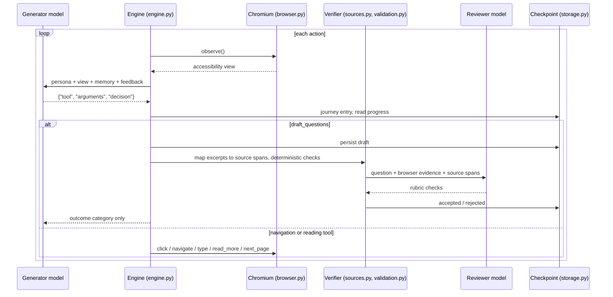
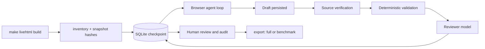

# Golden dataset architecture

This page explains how the golden dataset tool is built: how the agent works, which
module owns what, and where the trust boundaries are. To run the tool, start with the
[quickstart](README.md). For exact formats, browser behavior, and audit rules, see
[the reference](REFERENCE.md).

The tool builds a retrieval benchmark from the documentation app you already run with
`make livehtml`. An LLM agent reads the site in a real Chromium browser and writes the
questions a reader would ask. Each question cites exact text the agent saw in the
browser. The tool then maps that text back to exact lines in the `.rst`/`.md` sources.
The result is a set of queries, each paired with the source locations that answer it.

## How the agent works

The agent behaves like a person reading the documentation, not like a crawler that
parses files.

1. **It sees the page as a reader does.** Each step, the *generator* model receives
   one view of the current page, built from Chromium's accessibility snapshot. The view
   contains the article sections, the sidebar menu, article links, tabs and expandable
   panels, the search box, and progress counters. The model cannot see source files,
   the filesystem, or raw HTML, and it cannot run JavaScript.
2. **It picks one action.** The model replies with a single JSON action: `click`,
   `back`, `navigate`, `type`, `keypress`, `read_more`, `next_page`,
   `draft_questions`, or `finish`. Playwright performs the action in Chromium and the
   next view comes back.
3. **Reading is tracked.** Content counts as read once a model response has seen it.
   A rolling memory of about 16,000 characters of recent reading travels with each
   request, so the agent can write cross-page questions. Personas (new developer,
   application engineer, platform operator) rotate between questions.
4. **It drafts questions where a reader would ask them.** A substantive page gets up
   to three questions. Each question carries a reference answer, required facts, and
   evidence groups that quote exact excerpts from observations the agent has read.
5. **Drafts are checked where the generator can't see.** Each draft is saved to the
   checkpoint *before* any check runs. Then:
   - excerpts are mapped to exact source spans through the Sphinx doctrees,
   - deterministic checks confirm the evidence, scope, and fact coverage, and
   - a separate *reviewer* model grades the question against a rubric, using both the
     browser evidence and the verified source text.

   The generator learns only whether a draft passed and a broad failure category. It
   never sees sources or verifier output, so it cannot tune drafts to pass the checks.
6. **It keeps going until coverage is complete.** The loop continues until every
   in-scope page has been visited and fully read, including its tabs and panels. That
   rule is enforced in code; a `finish` from the model cannot override it. Limits,
   provider errors, and loops pause the run. `resume` picks up from the checkpoint.
7. **Humans close the loop.** After generation, people review questions in a local web
   UI, an audit sample gates the release, and `export` writes the benchmark.



## Pipeline



On the first `generate`, the tool registers the existing build. It records hashes of
every documentation input and rendered page and audits navigation metadata. Every later
command checks that snapshot first, and source or build drift stops the run. The tool
writes to one checkpoint throughout, so any command can stop and resume.

## Module map

| Module | Responsibility |
| --- | --- |
| `__main__.py` | CLI and subcommands (`generate`, `resume`, `status`, `review`, `audit`, `export`, `paraphrase`, `inventory`). Registers the build on the first `generate`. Exit codes `0` done, `1` error, `2` paused. |
| `snapshot.py` | `inventory()` builds the initial schema 3.1 state from the build and sources. `verify_snapshot()` detects source and rendered-page drift and tolerates the live-reload script. |
| `coverage.py` | Private metadata audit of navigation and link targets: reachable pages, orphans, and exclusions. No article prose reaches generation. |
| `storage.py` | `Store` keeps the whole run state as one JSON checkpoint row in SQLite (WAL). `writer()` is an OS file lock that allows a single writer across generation and review. |
| `engine.py` | The agent loop `run()`, the generator prompt `TOOL_TASK`, `draft()` and `revalidate()`, pause conditions, and `paraphrase_existing()`. |
| `browser.py` | `Browser` wraps Playwright Chromium. It parses accessibility snapshots into views, tracks delivered and consumed content, builds memory, blocks off-origin requests, and implements `next_page()` and the browser tools. |
| `model.py` | Chat Completions `Client` for the `generator` and `reviewer` roles. `load_config()` reads `.env`. Also handles token and cost reservations, retries, and preflight. Raises `Paused` and `InvalidOutput`. |
| `sources.py` | Maps browser evidence to exact source spans using Sphinx doctrees, including included files. Produces the public section and candidate records. |
| `validation.py` | `create_candidate()`, the deterministic `validate()`, the reviewer rubric `review_candidate()`, and paraphrase checks. |
| `reporting.py` | Coverage metrics, `browsing_complete()` and readiness gates, stratified audit selection, and the full export. |
| `benchmark.py` | Retrieval benchmark export: `queries.jsonl` and `manifest.json`. |
| `review.py`, `review.html` | Loopback-only review server and UI for approving, rejecting, and editing questions. |
| `tracing.py` | Timestamped stderr traces and heartbeats for long stages. Traces never include requests, credentials, or source text. |

## Run state

All state lives in one JSON document in the checkpoint database
(`_build/golden-dataset/run.sqlite3` by default). `snapshot.inventory()` creates it.

| Key | Contents | Written by |
| --- | --- | --- |
| `snapshot`, `snapshot_id` | Commit, source and rendered hashes, build command, scope | `snapshot.py` |
| `pages`, `sections` | Per page: visited flag, controls, and sections. Per section: read units, attempts, source mapping | `snapshot.py`, `browser.py`, `engine.py` |
| `expected_pages`, `coverage_audit` | Pages in scope, plus reachable, orphan, excluded, and promoted pages | `snapshot.py`, `browser.py` |
| `observations` | Text the browser delivered, split into chunks with read flags | `browser.py` |
| `browser` | Last URL, discovered URLs, recent observations, search failures, broken links | `browser.py` |
| `journey` | Every action with persona, decision, and URL | `engine.py` |
| `candidates` | Every drafted question with validation, review, and human history | `validation.py`, `review.py` |
| `api_calls` | Per-request reservations and actual usage | `model.py` |
| `audit`, `runtime` | Audit sample and failures; run status and pause reason | `reporting.py`, `engine.py` |

The engine saves a checkpoint after every action, every draft, and every API call. A
crash or Ctrl+C therefore loses at most the step in flight.

## The agent loop

`engine.run()` does the following:

1. Verifies the snapshot, opens Chromium, runs a one-time API preflight, and
   revalidates any drafts left pending.
2. For each action, up to `GOLDEN_BROWSER_MAX_ACTIONS`: asks the generator, marks the
   delivered view as consumed, records the action in `journey`, and dispatches it.
   `draft_questions` runs verification. `finish` is accepted only when
   `browsing_complete()` holds. Every other tool goes to `Browser`.
3. Stops when browsing is complete, or pauses when:
   - the section limit (`GOLDEN_MAX_SECTIONS`) or the action limit is reached,
   - the generator returns three malformed replies in a row,
   - the same action repeats six times on unchanged content,
   - the snapshot drifts,
   - the provider budget or API fails, or
   - the user interrupts the run.

Invalid actions, stale references, and broken links don't stop the run. They become
`feedback` for the next generator request, so the model can choose another action.

## Candidate lifecycle

```text
drafted (status=pending_revalidation)
  ├─ source_failed  → rejected            evidence could not be mapped to sources
  └─ source_verified
       ├─ deterministic errors → rejected
       └─ reviewed → accepted | rejected  reviewer rubric
accepted ── human review ── approved | rejected | edited (→ pending_revalidation)
```

Each section gets three draft attempts. If the reviewer returns a malformed reply, the
draft stays `pending_revalidation` and is checked again on the next `resume`. Editing a
question in review sends it back through verification. A paraphrase that fails review
is withheld from export but never causes its question to be rejected.

## Trust and isolation boundaries

- **Documentation is untrusted data.** Prompts tell both models never to follow
  instructions found in page text.
- **The generator sees only the browser.** It gets accessibility views, its memory, and
  outcome categories. It never sees source files, verifier snippets, or source
  mappings.
- **The reviewer is independent.** It runs on a separately configured model and sees
  the browser evidence together with the verified source spans.
- **The browser stays in the app.** Navigation must stay inside the documentation
  origin. Raw `_sources` views are refused, and so is any URL not seen in an
  observation. Off-origin requests are blocked except rendering libraries.
- **Only trusted doctrees are read.** Doctrees are Python pickles, so `sources.py` reads
  only local builds.
- **The review server is local.** It accepts loopback Host and Origin only and uses a
  session token. Writes require the single writer lock, so review can't edit while
  generation runs.

## Outputs

- `export --format benchmark` writes `queries.jsonl` and `manifest.json` for retrieval
  evaluation: queries, paraphrases, relevant source locations, and file hashes.
- `export` (full) writes every internal record for debugging: questions, candidates,
  sections, observations, accessibility snapshots, the journey, and coverage.
- An export is `candidate_incomplete` until browsing is complete, evidence integrity
  holds, and the human audit passes. Only then is it `audited_ready`, which
  `--ready-only` requires. See [audit, limits, and export](REFERENCE.md#audit-limits-and-export).

## Testing

`tests/test_workflow.py` runs the whole pipeline against real headless Chromium. It
uses local HTML/RST fixtures and a `MockProvider` that serves a compatible Chat
Completions API. The tests cover pipeline behavior, not model quality. Judging model
quality requires a run against a real provider. See [verification](REFERENCE.md#verification).
